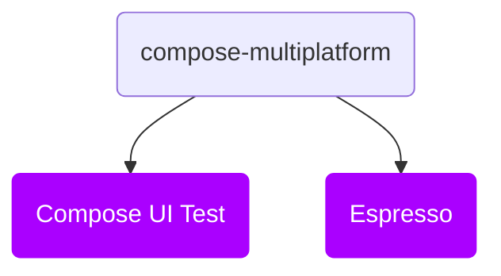

# Structure

### **Overview**

Kakao Compose Multiplatform ships as a single Kotlin Multiplatform module, targeting Android and iOS
(`iosArm64`, `iosSimulatorArm64`), with the following dependency structure:

### **Core**
#### `compose-multiplatform`
The foundational module that provides a DSL wrapper for Espresso methods, `ComposeScreen` page objects, and support for `KNode` and lists. Version 1+ maintains broad compatibility with version 0+, requiring minimal effort to upgrade.

Add it with: `implementation("io.github.kakaocup:compose-multiplatform:2.0.0")`

Usage examples are available in the [Sample project](https://github.com/KakaoCup/Multiplatform/tree/master/sample/src/androidTest/java/io/github/kakaocup/compose/test).
